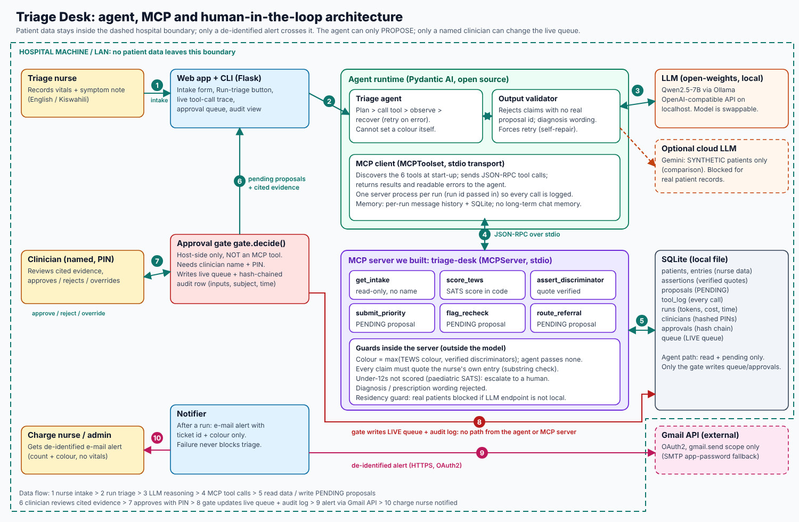
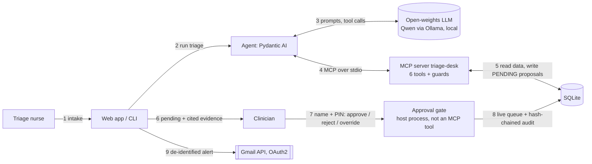

# Architecture

Editable source: `docs/architecture.svg`. The same flow as text:

## Components

| Component | Choice | Notes |
|---|---|---|
| Agent / orchestration | Pydantic AI (open source) | plan > call tool > observe > retry loop; output validator forces self-repair |
| Model | Open-weights, default `qwen2.5:7b` via Ollama | local OpenAI-compatible endpoint; swap with `TRIAGE_MODEL`. Gemini is allowed only for synthetic patients |
| Tools | **1 MCP server we built** (`triage-desk`), 6 tools | MCP SDK v2 `MCPServer`, stdio transport |
| MCP servers reused | none | see below |
| Rules engine | `sats.py`, pure code | TEWS bands, colour thresholds, discriminator catalogue |
| Storage | SQLite (WAL) | entries, proposals, tool log, runs, approvals, live queue |
| Human gate | `gate.py` | name + PIN, snapshot of inputs, hash-chained audit rows |
| Interfaces | Flask web app (127.0.0.1) and CLI | |
| External API | Gmail API (OAuth2, `gmail.send`) | only de-identified alerts and digests |

## MCP: built vs reused

**Built (1):** `triage-desk`, tools `get_intake`, `score_tews`, `assert_discriminator`, `submit_priority`,
`flag_recheck`, `route_referral`. **Reused (0).** No community server fitted a clinical triage domain with these guards.

**Why MCP instead of in-process functions:** the model can reach patient data only through six typed, logged tools; the
boundary is a process boundary (the server is started per run with a run id, so every call lands in `tool_log`); and
the same server can be used by any MCP client without changing the agent.

## Where the human gate sits

Every action the agent can take (`submit_priority`, `flag_recheck`, `route_referral`) only writes a row with
`status='pending'`. The live `queue` table is written by exactly one function, `gate.decide()`, which runs in the host
process and is **not exposed over MCP**. It requires a clinician name and PIN, stores a snapshot of the inputs, the
cited evidence and a timestamp, and appends a row to a hash chain (`verify_chain()` detects edits). Overrides require a
written reason. A test asserts the agent path leaves the queue empty.

## Safety rules enforced in code, outside the model

- The model never passes a colour or score: `colour = max(TEWS colour, verified discriminators)` is computed server-side.
- A discriminator needs the nurse's entry id and a **verbatim quote**, checked by substring match.
- Every evidence item cites a real entry id; a priority with no evidence is refused.
- Diagnosis and prescription wording is rejected (`guard_text`) in rationales and the final summary.
- Under-12s are not scored with the adult scale: escalated to paediatrics.
- Residency guard: a non-synthetic patient cannot be read when the model endpoint is not local.

## How the agent handles failure

| Failure | What happens |
|---|---|
| Quote not in the note, unknown id, diagnosis wording | tool returns a readable error; the agent corrects and retries (logged as a rejected call) |
| Vitals missing | no guessed priority; `flag_recheck` naming the missing measurements; provisional priority only if a discriminator exists |
| Final answer lists a proposal that does not exist, or claims the wrong outcome | output validator rejects it and the agent retries |
| Child under 12 | escalated to paediatrics, never scored |
| Model down, times out, or gives up | the run **fails safe**: no proposal is created, the patient stays in arrival order, the run is recorded with its error |
| E-mail fails | ignored for triage; reported in the run result |
| Concurrent use | SQLite WAL + busy timeout |

## Defensibility: audit and cost

- Sourced findings: each proposal lists the entry ids, quotes and per-vital points behind it.
- Readable log: `tool_log` (every call, args, result, ok/rejected) and the Agent runs page.
- Known cost per run: `runs` stores tool calls, tokens, wall time and cost (`PRICE_IN_PER_M` / `PRICE_OUT_PER_M`; $0 API on local hardware).
- Tamper evidence: `python -m triage_desk audit` verifies the hash chain.

## Known limits

Trimmed SATS discriminator catalogue (clinician verification needed), adults only, no real-patient validation, residual
prompt-injection risk (see [EVALS.md](EVALS.md)).
